<div align="center">

# Video Workflow / 视频工作流

**A bilingual workflow for lesson videos — voice, timing, captions, and the ten fonts that carry them.**<br>
**面向课程视频的中英双语工作流：配音、时间轴、字幕，以及承载文字的五款字族。**

[](./LICENSE)
[](./docs/FONTS.md)
[](./docs/FONTS.md)
[](./requirements.txt)
[](./CONTRIBUTING.md)

[Quick Start](#getting-started--快速开始) · [Font Directory](#font-directory--字体目录) · [Coverage](#character-set-coverage--字符集覆盖) · [Usage](#usage--使用指南) · [Contributing](#contributing--贡献方式) · [License](#license--开源许可证)

</div>

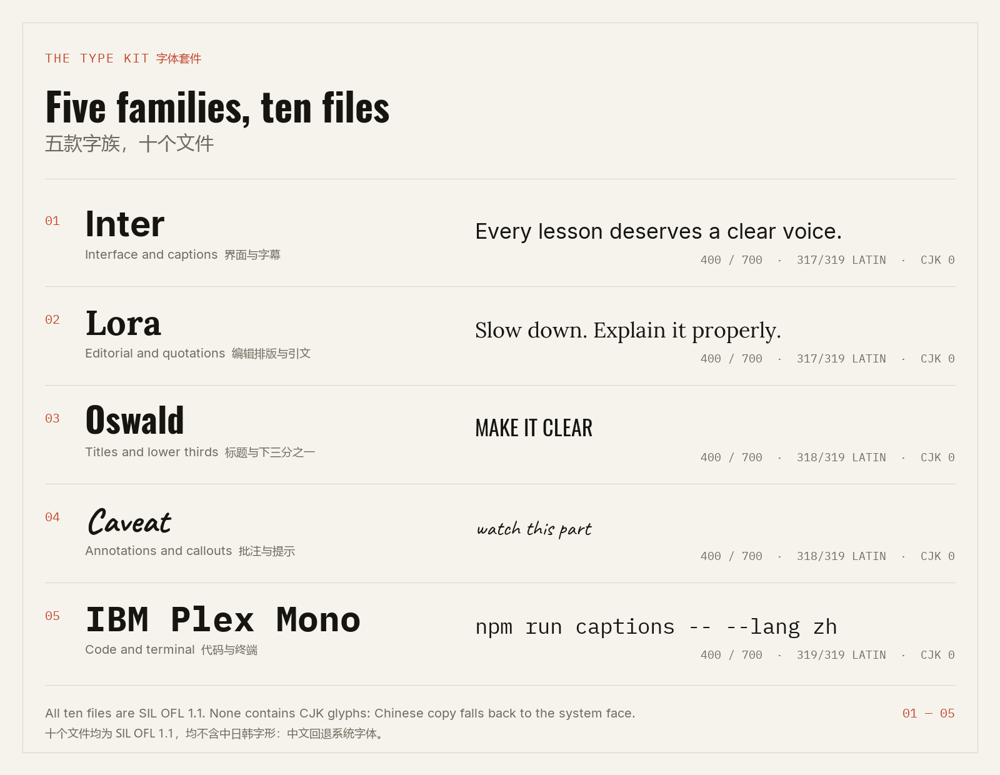

## Overview / 项目简介

**EN** — Video Workflow is the production layer for a lesson video: write the script, synthesize the
voice, force-align every word, set bilingual captions, then cut and export. It ships the part that is
usually missing from a pipeline repository: the actual type — five open-source families, two weights
each, measured glyph by glyph — plus the scripts that regenerate every number and image in this
document.

**中文** — 视频工作流是一节课程视频的制作层：写脚本、合成配音、对每个词做强制对齐、排双语字幕，
再剪辑导出。它还补上了流程仓库最常缺的那一块——真正可用的字体：五款开源字族、每款两个字重，
并逐字测量覆盖；以及重新生成本文所有数字与图片的脚本。

**EN** — This is a workflow, not a bundle of models. The editor (OpenScreen), the TTS model
(Qwen3-TTS) and the aligner (Qwen3-ForcedAligner) are pinned and documented, but they are not vendored
here. What lives here is the handoff between them, the caption/type tooling, and a specimen page that
can be opened without a build step.

**中文** — 这是一套工作流，不是模型合集。剪辑器（OpenScreen）、语音模型（Qwen3-TTS）与对齐模型
（Qwen3-ForcedAligner）在这里被固定版本、写清接口，但不随仓库分发。仓库真正拥有的是它们之间的交接、
字幕与字体工具，以及一个不需要构建就能打开的展示页。

### What This Repository Owns / 本仓库负责什么

| Owns / 负责 | Not vendored / 不分发 |
| --- | --- |
| The ten font files and their OFL notices · 十个字体文件与各自的 OFL 授权 | OpenScreen's Electron source · OpenScreen 的 Electron 源码 |
| Font measurement, proof rendering and the specimen page · 字体测量、样张渲染与展示页 | Qwen3-TTS / ForcedAligner weights (≈5.2 GB) · 语音与对齐模型权重（约 5.2 GB） |
| The caption builder and readability checks · 字幕生成器与可读性检查 | Demucs / torchaudio checkpoints · 人声分离模型权重 |
| The documented handoff between stages · 各阶段之间写明的交接格式 | Any Chinese typeface — none is redistributed · 任何中文字体，均不分发 |

## What Ships / 仓库内容

| Path / 路径 | What it is / 内容 |
| --- | --- |
| [`fonts/`](./fonts) | 10 TTF files + 5 OFL license texts · 10 个 TTF 与 5 份 OFL 授权文本 |
| [`index.html`](./index.html) | Offline specimen page: live preview, coverage, scenes · 离线展示页：实时预览、覆盖、场景 |
| [`docs/FONTS.md`](./docs/FONTS.md) | Full font directory with metadata and pairing notes · 完整字体目录、元数据与搭配建议 |
| [`docs/WORKFLOW.md`](./docs/WORKFLOW.md) | Stage contracts, model pins, caption spec · 阶段交接、模型版本、字幕规范 |
| [`docs/font-report.json`](./docs/font-report.json) | Machine-readable measurement of all 10 files · 十个文件的可机读测量结果 |
| [`docs/runtime-provenance.json`](./docs/runtime-provenance.json) | Voice and alignment pins, sanitized · 配音与对齐的版本记录（已去除本地路径） |
| [`docs/previews/`](./docs/previews) | Every image in this README, regenerated from the TTFs · 本文全部图片，由字体重新渲染 |
| [`tools/`](./tools) | Font report, proof renderer, site data, caption builder · 字体报告、样张渲染、页面数据、字幕工具 |
| [`samples/`](./samples) | A six-segment bilingual transcript and its SRT/ASS output · 六段双语示例及生成的字幕 |

## The Pipeline / 工作流

**EN** — Six stages, each with one owner and one output. The script decides the words; the voice and
the aligner decide the time; the captions and the type decide what the viewer reads. The full handoff
contract is in **[docs/WORKFLOW.md](docs/WORKFLOW.md)**.

**中文** — 六个阶段，各有一个负责者与一份产出：脚本决定说什么，配音与对齐决定什么时候说，
字幕与字体决定观众读到什么。完整的交接约定见 **[docs/WORKFLOW.md](docs/WORKFLOW.md)**。

| Stage / 阶段 | Tool / 工具 | Output / 产出 |
| --- | --- | --- |
| 01 Script · 脚本 | Markdown · Markdown | Sentence-sized segments, both languages · 按句切分的双语文段 |
| 02 Voice · 配音 | Qwen3-TTS 12 Hz, CustomVoice · Qwen3-TTS 12 Hz | Mono voice track at the model rate · 模型原生采样率的单声道人声 |
| 03 Timing · 对齐 | Qwen3-ForcedAligner 0.6B · 强制对齐模型 | Word-level timestamps · 词级时间戳 |
| 04 Captions · 字幕 | [`tools/build_captions.py`](./tools/build_captions.py) | Bilingual SRT + ASS, CPS checked · 双语 SRT/ASS，已检查 CPS |
| 05 Edit · 剪辑 | OpenScreen 2.0 · 剪辑器 | Editable project, MP4/GIF export · 可编辑工程与导出 |
| 06 Type · 字体 | This kit · 本仓库字体 | Titles, captions, quotes, code, callouts · 标题、字幕、引文、代码、批注 |

## Font Directory / 字体目录

**EN** — Five families, two weights each, ten files, 2.3 MB in total. Every family is here because it
does one job in a lesson video better than the others; none is decoration. All ten are licensed under
the SIL Open Font License 1.1, so they can travel with a commercial course.

**中文** — 五款字族、每款两个字重、共十个文件、合计 2.3 MB。每款字体都是因为它在一节课程视频里
把某件事做得比别的字体好，而不是为了凑数。十款全部采用 SIL Open Font License 1.1，可以随商业课程一起分发。

| Family / 字族 | Role / 定位 | Weights / 字重 | Latin core / 拉丁核心 | CJK / 中日韩 | License / 授权 |
| --- | --- | --- | ---: | ---: | --- |
| **Inter** | Interface and captions · 界面与字幕 | 400 / 700 | 317/319 | 0 | OFL 1.1 |
| **Lora** | Editorial and quotations · 编辑排版与引文 | 400 / 700 | 317/319 | 0 | OFL 1.1 |
| **Oswald** | Titles and lower thirds · 标题与下三分之一 | 400 / 700 | 318/319 | 0 | OFL 1.1 |
| **Caveat** | Annotations and callouts · 批注与提示 | 400 / 700 | 318/319 | 0 | OFL 1.1 |
| **IBM Plex Mono** | Code and terminal · 代码与终端 | 400 / 700 | 319/319 | 0 | OFL 1.1 |

<table>
  <tr>
    <td width="50%">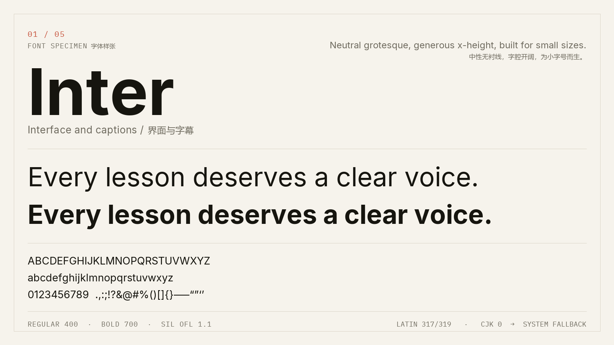</td>
    <td width="50%">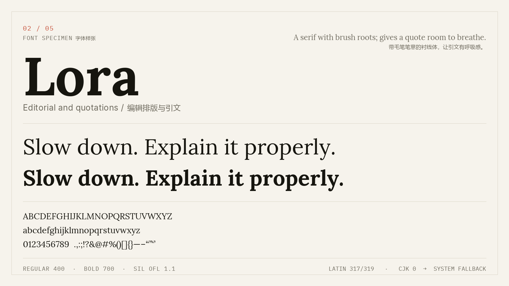</td>
  </tr>
  <tr>
    <td width="50%">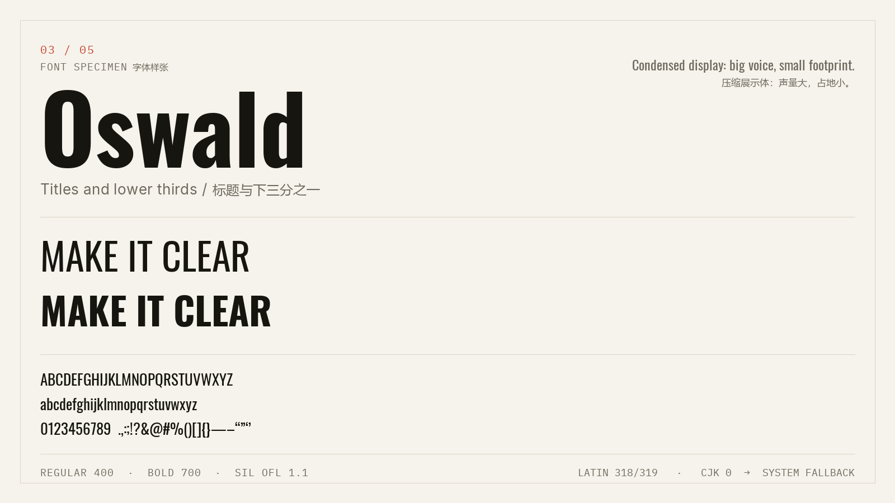</td>
    <td width="50%">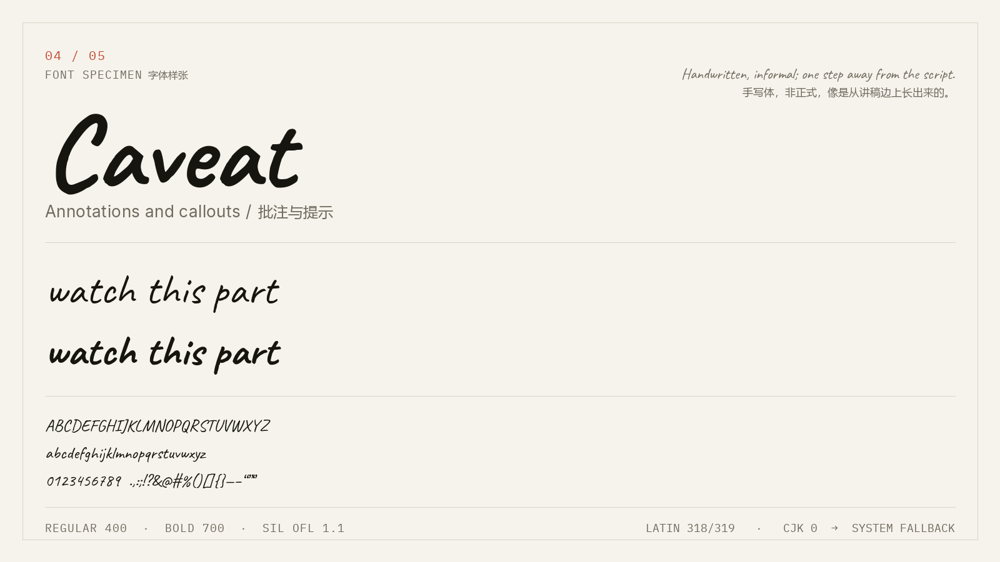</td>
  </tr>
  <tr>
    <td width="50%">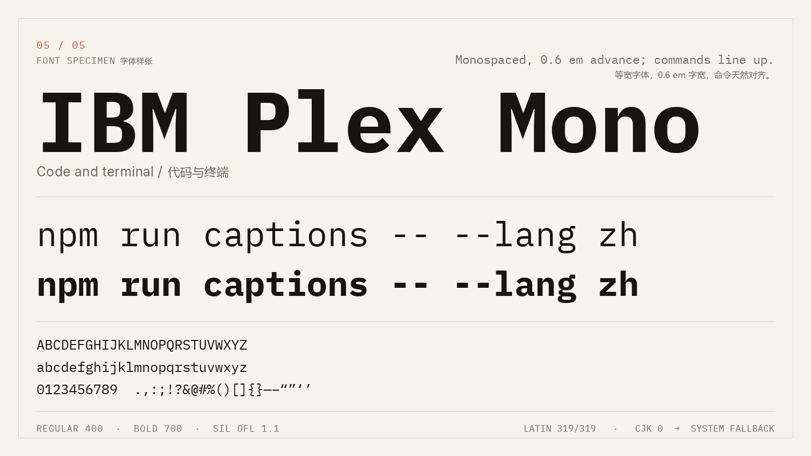</td>
    <td width="50%" valign="middle">
      <strong>Full metadata / 完整元数据</strong><br><br>
      Designer, version, glyph count, mapped codepoints, every Unicode block and the exact download
      names live in <a href="docs/FONTS.md">docs/FONTS.md</a>.<br><br>
      设计者、版本、字形数、字符映射数、逐区块覆盖与下载文件名，见
      <a href="docs/FONTS.md">docs/FONTS.md</a>。
    </td>
  </tr>
</table>

## Character Set Coverage / 字符集覆盖

**EN** — The Latin core here means Basic Latin (95 printable characters) + Latin-1 Supplement (96) +
Latin Extended-A (128): 319 characters in total. Every family covers 317 to 319 of them; the gaps are
the soft hyphen and one or two rare letters. No family ships a single CJK glyph — that is a property
of the source families, not a packaging mistake.

**中文** — 这里的“拉丁核心”指基本拉丁（95 个可打印字符）+ 拉丁-1 补充（96）+ 拉丁扩展-A（128），
共 319 个字符。五款字体覆盖 317–319 个，缺口只有软连字符和一两个罕见字母。五款字体都不含任何
中日韩字形——这是源字族本身的属性，不是打包遗漏。

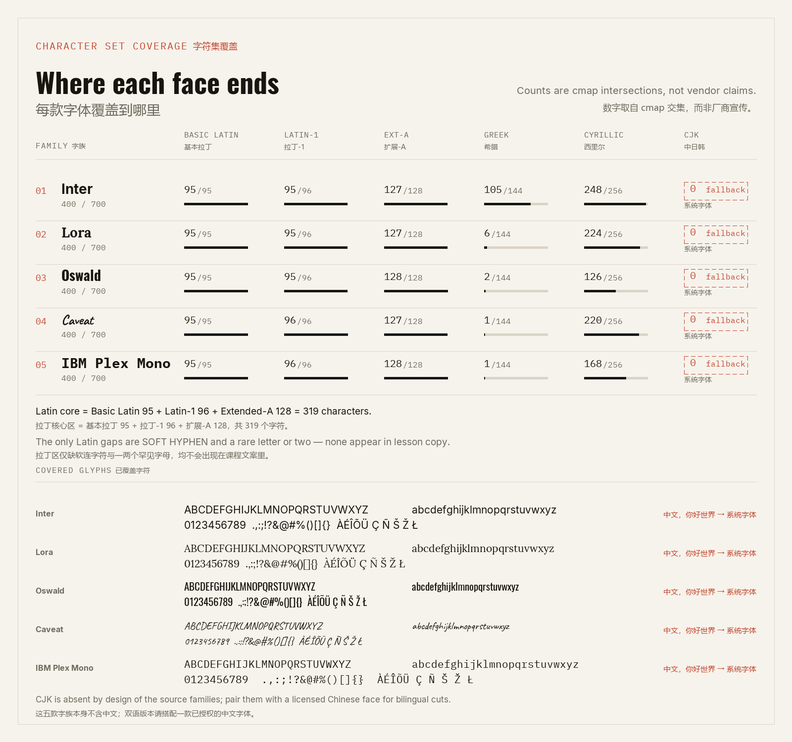

| Family / 字族 | Basic / 基本 | Latin-1 | Ext-A | Greek / 希腊 | Cyrillic / 西里尔 | CJK |
| --- | ---: | ---: | ---: | ---: | ---: | ---: |
| Inter | 95/95 | 95/96 | 127/128 | 105/144 | 248/256 | 0/20,992 |
| Lora | 95/95 | 95/96 | 127/128 | 6/144 | 224/256 | 0/20,992 |
| Oswald | 95/95 | 95/96 | 128/128 | 2/144 | 126/256 | 0/20,992 |
| Caveat | 95/95 | 96/96 | 127/128 | 1/144 | 220/256 | 0/20,992 |
| IBM Plex Mono | 95/95 | 96/96 | 128/128 | 1/144 | 168/256 | 0/20,992 |

**EN** — Chinese copy therefore falls back to the operating system's CJK face — Microsoft YaHei on
Windows, PingFang SC on macOS, Noto Sans CJK on Linux — exactly as it will in a renderer. The preview
images show that fallback at real size instead of substituting a borrowed Chinese font.

**中文** — 因此中文会回退到操作系统的 CJK 字体——Windows 的微软雅黑、macOS 的苹方、Linux 的
Noto Sans CJK——这与渲染器里的实际行为一致。预览图按真实字号展示该回退，而不是借一款中文字体来伪装。

> **Pairing advice / 搭配建议** — For bilingual cuts, pair these Latin faces with a licensed Chinese
> face such as Noto Sans SC or Source Han Sans (both OFL). Do not copy a system font file into a
> distributed build. 双语版本请搭配已授权的中文字体，如 Noto Sans SC 或思源黑体（均为 OFL）。
> 不要把系统字体文件复制进对外分发的构建产物。

## In Use / 应用场景

**EN** — Four frames rendered from the shipped files: an opening title, a bilingual subtitle, end
credits and an annotation layer. Each frame gives one family the focal line; every other slot uses the
family suited to its job, never the featured face everywhere.

**中文** — 四张画面均由仓库字体渲染：片名卡、双语字幕、片尾字幕与批注层。每张画面只让一款字族
承担主视觉，其他位置按职责选字，而不是全套用同一款。

<table>
  <tr>
    <td width="50%">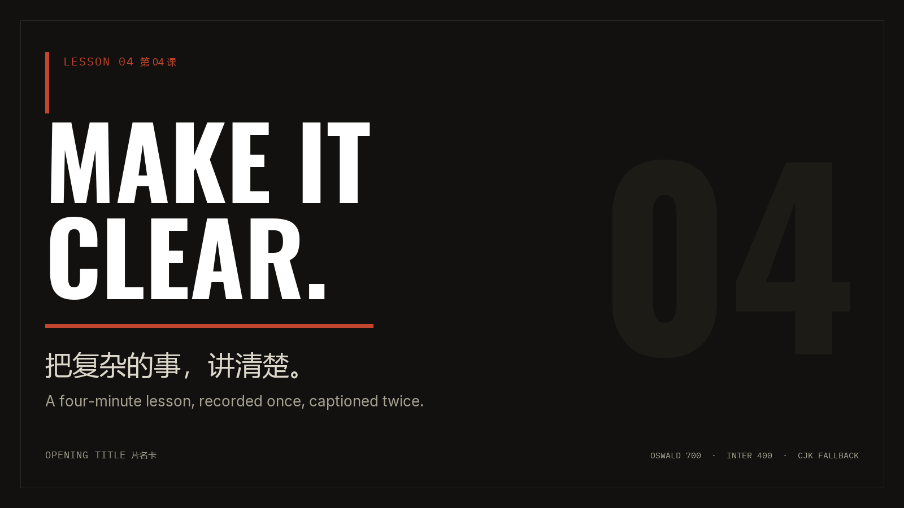<br><strong>Opening title / 片名卡</strong> — Oswald 700 + Inter 400. 主标题 Oswald，副标题 Inter。</td>
    <td width="50%">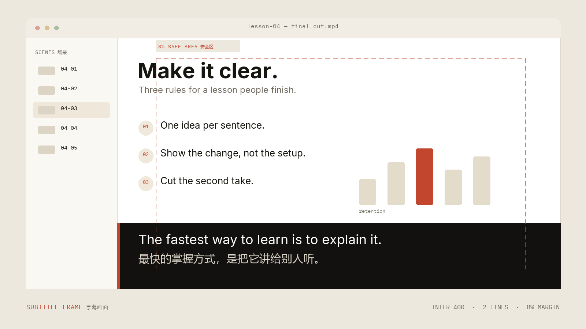<br><strong>Subtitle frame / 字幕画面</strong> — two lines, 8% safe area. 两行，8% 安全区。</td>
  </tr>
  <tr>
    <td width="50%">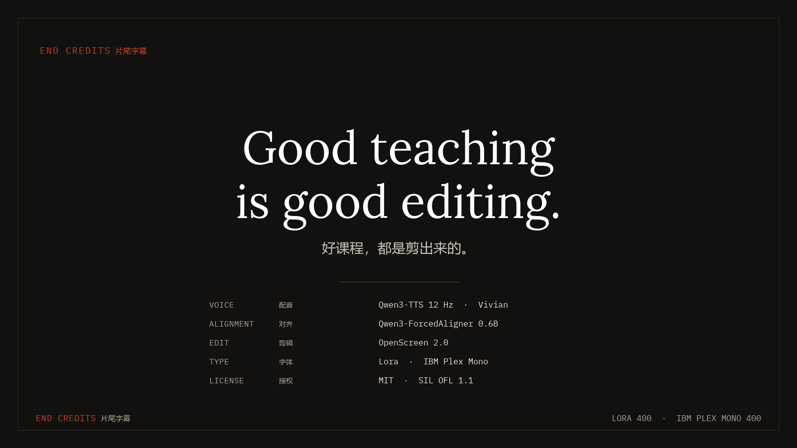<br><strong>End credits / 片尾字幕</strong> — Lora 400 + IBM Plex Mono. 引文与名单。</td>
    <td width="50%">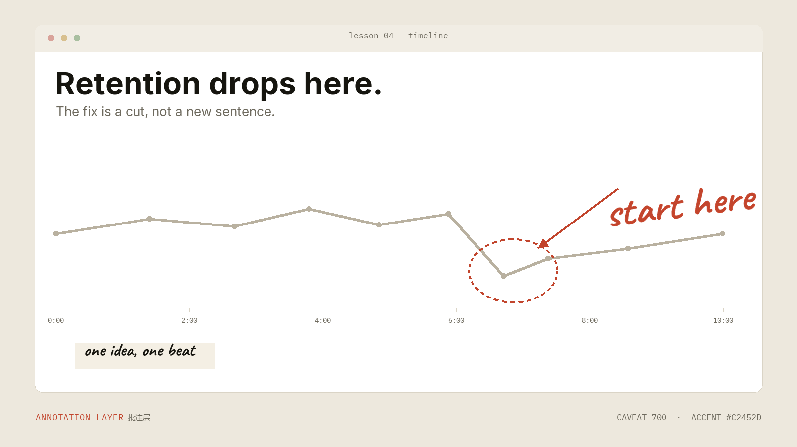<br><strong>Annotation layer / 批注层</strong> — Caveat 700, one arrow. 手写批注配箭头。</td>
  </tr>
</table>

## Showcase / 展示页

**EN** — `index.html` is a single static page with a live type tester, a block-by-block coverage
explorer, the four scenes above, and the workflow. It reads the local TTFs; no build, no CDN, no
network. Open it directly or serve the folder.

**中文** — `index.html` 是一个静态页面：实时试排、逐区块覆盖浏览、上面四张场景，以及工作流说明。
它直接读取本地 TTF，无构建、无 CDN、无网络请求。双击打开或起一个静态服务器即可。

[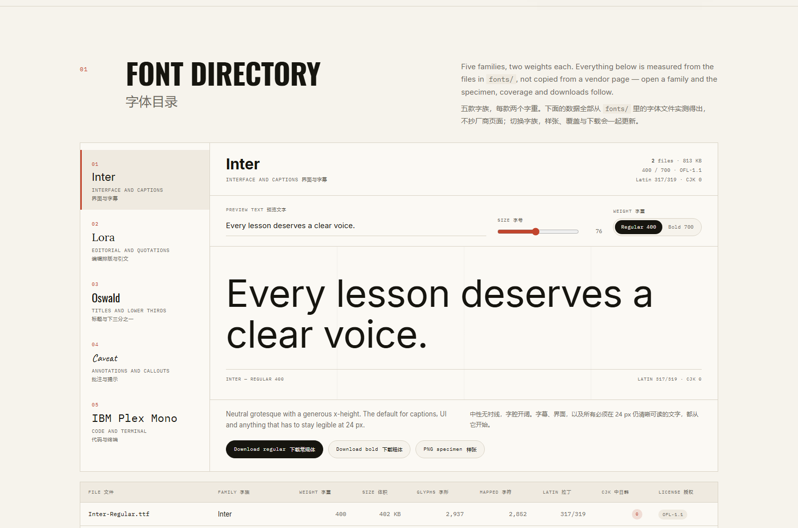](https://edwinzdz.github.io/video-workflow/)

**Live page / 在线页面** — <https://edwinzdz.github.io/video-workflow/> ·
**Local / 本地** — `python -m http.server 8080`, then open `http://localhost:8080`.

## Getting Started / 快速开始

### Requirements / 环境要求

**EN** — Python 3.10 or newer for the tools; a browser for the showcase. Node.js is not required.
The font files themselves work in any editor, compositor or web page.

**中文** — 工具需要 Python 3.10 及以上；展示页只需浏览器。不需要 Node.js。字体文件本身可用于任意
剪辑器、合成器或网页。

```bash
git clone https://github.com/EdwinZDZ/video-workflow.git
cd video-workflow
python -m venv .venv
# Windows
.venv\Scripts\activate
# macOS / Linux
source .venv/bin/activate
pip install -r requirements.txt
```

### Regenerate the proofs / 重新生成样张

```bash
python tools/font_report.py --fonts fonts --out docs/font-report.json
python tools/build_site_data.py
python tools/render_previews.py
```

**EN** — The report reads the `cmap` tables; the images read the report; the page reads the generated
`data/font-data.js`. Change one font and all three follow. The proof renderer needs a system CJK face
for the bilingual labels; set `CJK_FONT=/path/to/font.ttc` if it cannot find one.

**中文** — 报告读取 `cmap` 表，图片读取报告，页面读取生成的 `data/font-data.js`。换一款字体，
三者会一起更新。样张渲染需要系统中的中文字体来排双语标签；若脚本找不到，请设置
`CJK_FONT=/path/to/font.ttc`。

### Open the showcase / 打开展示页

```bash
python -m http.server 8080
# http://localhost:8080
```

## Usage / 使用指南

### Set type in an editor / 在剪辑器里排字

**EN** — Copy the family you need plus its `-OFL.txt` file. Use Regular for running copy and Bold for
emphasis; both weights are real files, not synthesized. Chinese will fall back to the system face, so
set the Chinese line in your editor explicitly if the renderer supports a font stack.

**中文** — 复制需要的字族及其 `-OFL.txt`。正文用 Regular，强调用 Bold；两个字重都是真实文件，不靠
算法合成。中文会回退系统字体，若渲染器支持字体栈，请显式指定中文那一行。

```css
@font-face {
  font-family: "Inter";
  src: url("fonts/Inter-Regular.ttf") format("truetype");
  font-weight: 400;
  font-display: swap;
}

.caption-en {
  font-family: "Inter", sans-serif;
  font-weight: 400;
}

.caption-zh {
  font-family: "PingFang SC", "Microsoft YaHei", "Noto Sans CJK SC", sans-serif;
}
```

### Build captions / 生成字幕

**EN** — Feed the caption builder the JSON that comes out of alignment: one segment per sentence,
both languages, start/end in seconds. It wraps at 42 Latin / 20 Chinese characters per line, limits
each cue to two lines, and checks CPS, duration and overlap before writing SRT and ASS.

**中文** — 把对齐后的 JSON 交给字幕工具：一句一段、双语齐全、起止时间以秒为单位。它会按每行
42 个拉丁字符 / 20 个汉字断行，限制每条字幕两行，并在写出 SRT 与 ASS 前检查 CPS、时长与重叠。

```bash
python tools/build_captions.py build samples/lesson.transcript.json --out samples/lesson
python tools/build_captions.py check samples/lesson.transcript.json
```

**Output / 产出** — `lesson.en.srt`, `lesson.zh.srt`, `lesson.bilingual.ass` (two ASS styles: Inter
for English, system CJK for Chinese). ASS margins assume 1920×1080; change the style block for other
frames. · 输出三个文件：英文 SRT、中文 SRT、双语 ASS（两个样式：英文 Inter，中文系统字体）。
ASS 边距按 1920×1080 设定，其他画幅请改样式块。

### Run the full pipeline / 跑完整流程

**EN** — Stage-by-stage commands, model revisions and the exact handoff shapes are in
**[docs/WORKFLOW.md](docs/WORKFLOW.md)**. The short version: script → TTS → forced alignment →
`build_captions.py` → OpenScreen → export.

**中文** — 逐阶段命令、模型版本与交接格式见 **[docs/WORKFLOW.md](docs/WORKFLOW.md)**。简版：
脚本 → 语音合成 → 强制对齐 → `build_captions.py` → OpenScreen → 导出。

### License obligations / 授权义务

**EN** — The OFL allows commercial use, modification and redistribution, including bundling in a
product. It requires that the copyright notice and license travel with the font, that modified
versions not use the Reserved Font Name, and that the font not be sold by itself. Read
[docs/FONTS.md](docs/FONTS.md#licenses--授权) before shipping.

**中文** — OFL 允许商用、修改与再分发，也允许随产品打包；但要求版权声明与授权文本随字体一起提供，
修改版不得使用保留字体名，且不得单独售卖字体本身。分发前请阅读
[docs/FONTS.md](docs/FONTS.md#licenses--授权)。

## Project Structure / 项目结构

```
video-workflow/
├── index.html                # showcase, no build / 展示页，无构建
├── assets/                   # site.css, site.js / 页面样式与交互
├── fonts/                    # 10 TTF + 5 OFL texts / 字体与授权
├── data/
│   └── font-data.js          # generated metrics + cmap / 生成的度量与字符表
├── docs/
│   ├── FONTS.md              # font directory / 字体目录
│   ├── WORKFLOW.md           # stage contracts / 工作流交接
│   ├── font-report.json      # measurement / 测量结果
│   ├── runtime-provenance.json # voice + alignment pins / 配音与对齐版本
│   ├── previews/             # generated images / 生成的图片
│   └── screenshots/          # page capture / 页面截图
├── tools/
│   ├── font_report.py        # cmap → JSON / 字体测量
│   ├── render_previews.py    # JSON + TTF → PNG / 样张渲染
│   ├── build_site_data.py    # JSON → font-data.js / 页面数据
│   └── build_captions.py     # JSON → SRT + ASS / 字幕生成
├── samples/                  # transcript + captions / 示例与产物
├── requirements.txt
├── CONTRIBUTING.md · NOTICE.md · LICENSE
└── README.md
```

## Contributing / 贡献方式

**EN** — Bug reports, translation fixes, new scene presets and better caption checks are welcome.
A font change must include its OFL text, a regenerated report, regenerated previews and a passing
`build_captions.py check` if the sample changed. Read **[CONTRIBUTING.md](CONTRIBUTING.md)** first —
the short version is there too.

**中文** — 欢迎提交 bug、翻译修订、新场景版式与更严格的字幕检查。更换字体必须同时提交 OFL 文本、
重新生成的报告与预览图；若改了示例字幕，还需通过 `build_captions.py check`。请先读
**[CONTRIBUTING.md](CONTRIBUTING.md)**，里面也有简版清单。

## License / 开源许可证

**EN** — The code, documentation and showcase are released under the [MIT License](./LICENSE).
The ten font files remain under the SIL Open Font License 1.1, with their original copyright notices
in [`fonts/`](./fonts). The models referenced by the workflow are Apache-2.0. See
[NOTICE.md](./NOTICE.md) for the full breakdown and upstream credits.

**中文** — 代码、文档与展示页采用 [MIT 许可证](./LICENSE)。十个字体文件沿用 SIL Open Font
License 1.1，原始版权声明保存在 [`fonts/`](./fonts)。工作流引用的模型为 Apache-2.0。完整说明与
上游致谢见 [NOTICE.md](./NOTICE.md)。

## Acknowledgements / 致谢

**EN** — OpenScreen (MIT) for the editing and export engine; Qwen3-TTS and Qwen3-ForcedAligner
(Apache-2.0) for voice and timing; Demucs (MIT) for reference-vocal cleanup; Rasmus Andersson, Olga
Karpushina, Alexei Vanyashin, Vernon Adams, Pablo Impallari and the IBM Plex team for the type.

**中文** — 感谢 OpenScreen（MIT）提供剪辑与导出引擎，Qwen3-TTS 与 Qwen3-ForcedAligner（Apache-2.0）
提供配音与时间轴，Demucs（MIT）清理参考人声；感谢 Rasmus Andersson、Olga Karpushina、
Alexei Vanyashin、Vernon Adams、Pablo Impallari 与 IBM Plex 团队设计这些字体。

---

<div align="center">
<sub>English first, Chinese second — in every heading, table and interface label. · 英文在前，中文在后——所有标题、表格与界面文案皆然。</sub>
</div>
